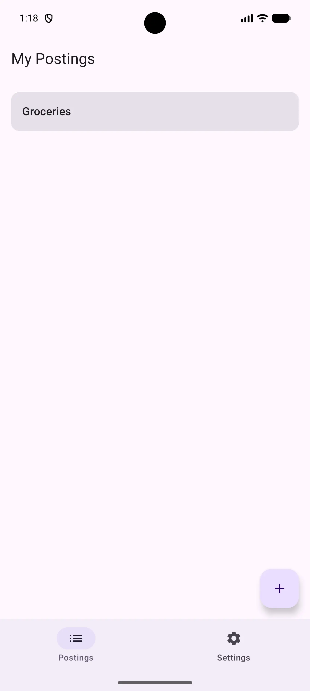
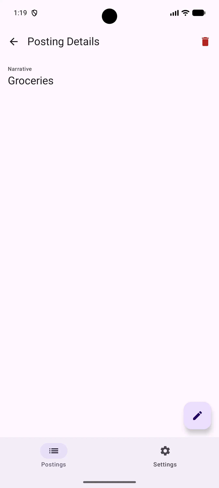
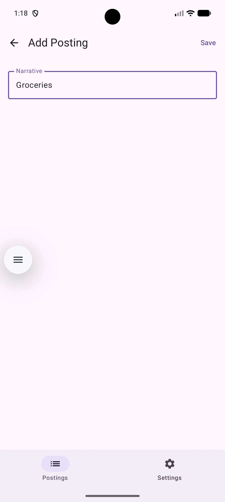
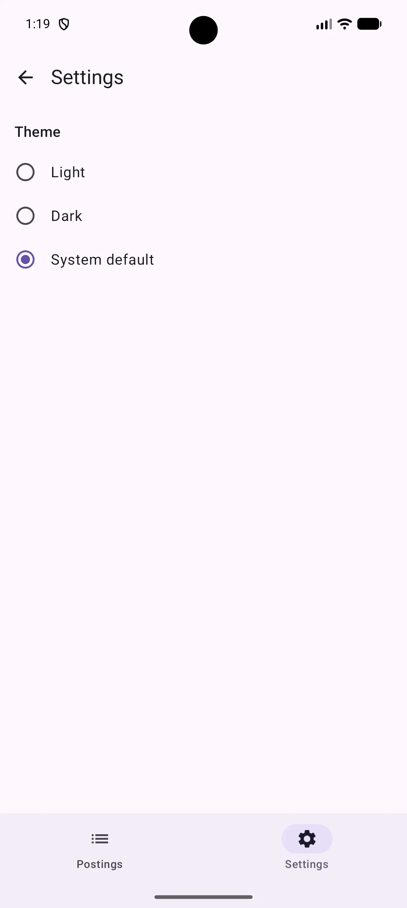
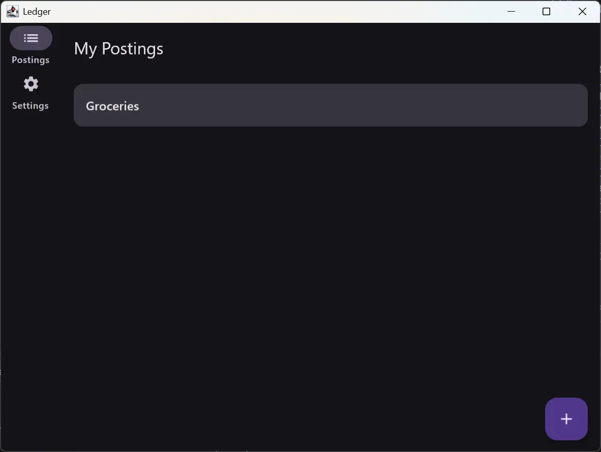
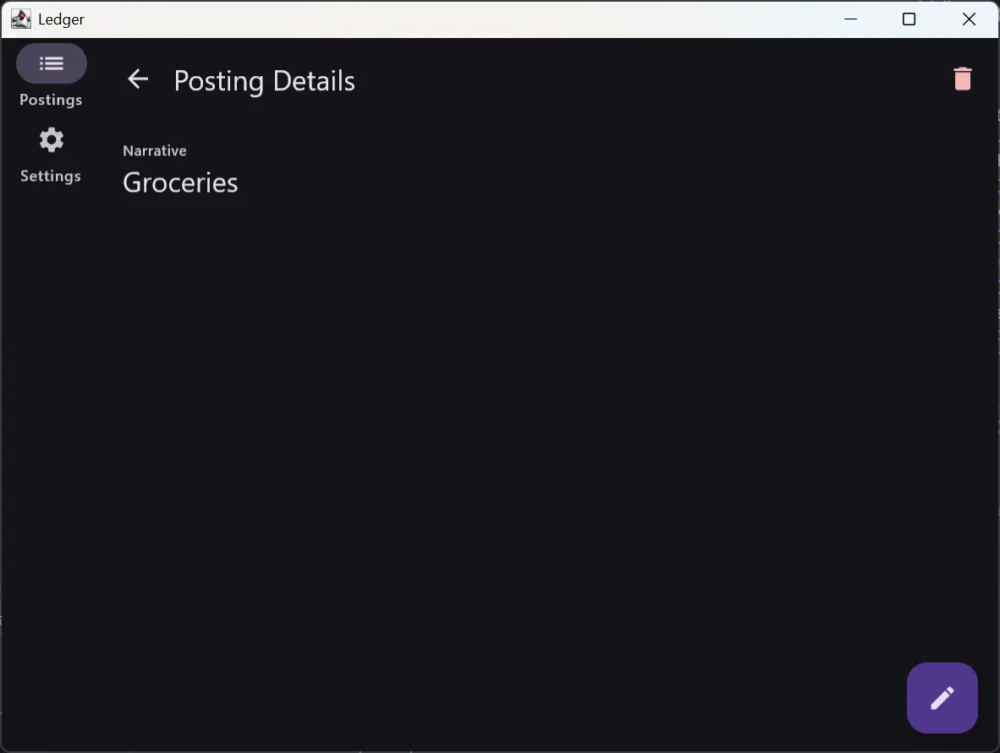
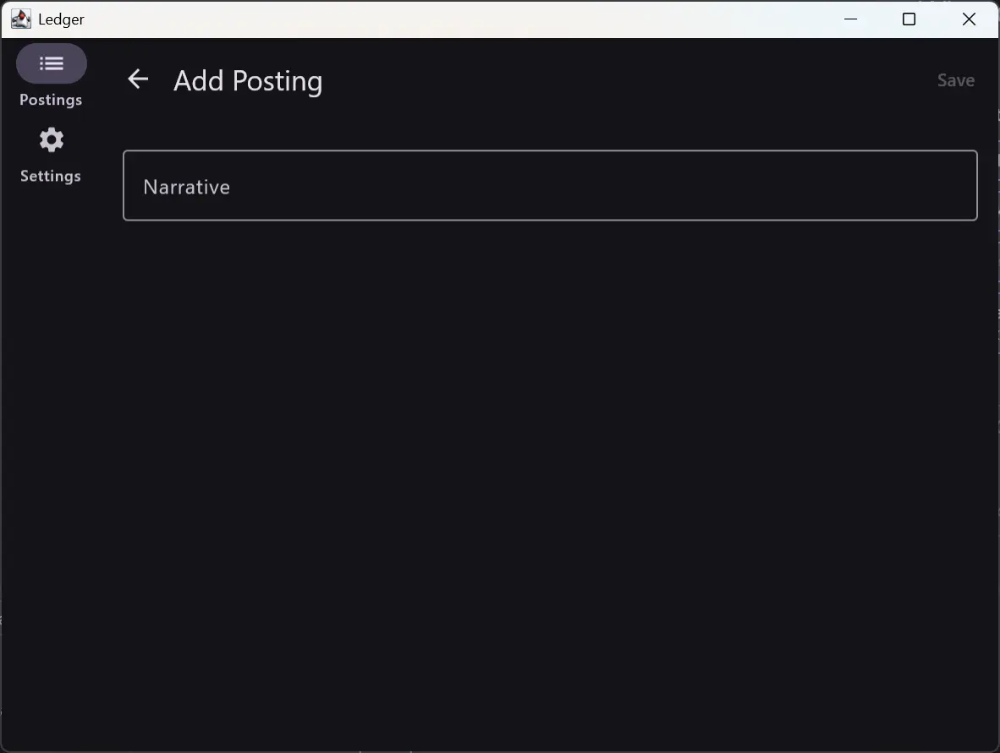
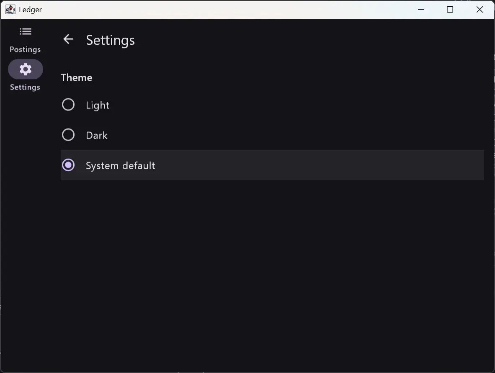

# Ledger


[](https://scorecard.dev/viewer/?uri=github.com/aoreshkov/kmp-ledger)
[](https://github.com/sponsors/aoreshkov)
[](https://plugins.jetbrains.com/plugin/31786-kmp-project-wizard)

**Supported Platforms:**


---

**Ledger** is a Kotlin Multiplatform reference project for Android, iOS, and Desktop. Its primary goal is to demonstrate production-grade architecture and design patterns using the latest Jetpack and Compose Multiplatform libraries — including a few that are still pre-release. It is intentionally simple in domain (basic financial postings) so that the architecture, not the business logic, is the focus.

> **Important:** This is a **showcase project — use it as a template and a reference for new projects, not as an app to keep data in.** It ships no database migrations: the database is built with Room's destructive fallback, so a release that bumps the schema version drops and recreates every table on first launch. Treat anything you enter here as disposable.

> **Note:** Kotlin, Compose Multiplatform, Room 3 / AndroidX SQLite, Koin, Coroutines, AndroidX DataStore, Lifecycle, and Material3 Adaptive are all on stable releases. The two exceptions are pinned to the exact coordinates the Compose Multiplatform release declares itself aligned to: the JetBrains Navigation 3 UI artifact (RC, on a stable Jetpack runtime) and the Material3 components, including the Adaptive Navigation Suite (Alpha). Pinned versions are recorded in [`gradle/libs.versions.toml`](gradle/libs.versions.toml).

---

## Generate This Project

Want this architecture as the starting point for your own app? The
[KMP Project Wizard](https://plugins.jetbrains.com/plugin/31786-kmp-project-wizard) plugin for
IntelliJ IDEA and Android Studio generates a project with this exact module structure straight
from **File → New Project** — tailored to your package name, feature and entity names, and
target platforms. Ledger is the open-source reference app the wizard's defaults mirror.

The core Android and Desktop templates are free. A **Pro** tier additionally generates the
Claude Code agent configuration and GitHub Actions CI scaffolding — the same setups you can
study in this repo (`.claude/`, `.github/workflows/`) — pre-wired to your project in one click.

---

## Screenshots

### Android

|                        Posting List                        |                         Posting Detail                         |                        Edit Posting                        |                          Settings                          |
|:----------------------------------------------------------:|:--------------------------------------------------------------:|:----------------------------------------------------------:|:----------------------------------------------------------:|
|  |  |  |  |

### Desktop

|                        Posting List                        |                         Posting Detail                         |                        Edit Posting                        |                          Settings                          |
|:----------------------------------------------------------:|:--------------------------------------------------------------:|:----------------------------------------------------------:|:----------------------------------------------------------:|
|  |  |  |  |

---

## Tech Stack

| Library | Version | Role |
|---|---|---|
| Kotlin | 2.4.20 | Language and compiler |
| Kotlin Gradle Plugin | 2.4.20 | Build tooling |
| Compose Multiplatform | 1.12.2 | Shared UI (Android, iOS, Desktop) |
| Room 3 / SQLite | 3.0.3 / 2.7.1 | Local database with KMP support |
| AndroidX DataStore (Preferences) | 1.3.0 | Multiplatform key-value persistence (theme preference) |
| Navigation 3 | 1.2.0 (runtime) / 1.2.0-rc01 (ui) | Type-safe declarative navigation |
| Material3 Adaptive Navigation Suite | 1.12.0-alpha03 | Adaptive top-level nav (bottom bar / rail / drawer) |
| Koin | 4.2.2 | Dependency injection with annotation processing |
| Kermit | 2.2.0 | Kotlin Multiplatform logging |
| Kover | 0.9.11 | Kotlin Multiplatform code coverage |
| SLF4J / Logback | 2.0.20 / 1.6.6 | Desktop logging implementation |
| Swift Export | Alpha | Direct Kotlin-to-Swift bridge (No Obj-C) |
| Kotlinx Coroutines | 1.11.0 | Async and Flow-based data streams |
| Lifecycle / ViewModel | 2.11.0 | State management and lifecycle-aware components |
| Material3 Adaptive | 1.3.0 | List/detail adaptive layouts |
| Material3 (Compose) | 1.12.0-alpha03 | Material You components |
| Android SDK | compile/target 37, min 24 | Android target |

---

## Architecture

Ledger follows a strict unidirectional layered architecture. Each layer depends only on the layer directly below it, and all domain types flow upward through mappers — never raw database entities.

```
┌─────────────────────────────────────┐
│ androidApp / iosApp / desktopApp    │  Platform entry points
└───────┬──────────────┬──────────────┘
        │              │
        │      ┌───────▼───────┐
        │      │   iosExport   │  Swift Export bridge
        │      └───────┬───────┘
        │              │
┌───────▼──────────────▼──────────────┐
│              core:ui                │  App composable, theme, NavigationSuiteScaffold, NavDisplay
│           core:navigation           │  Navigator, StartDestination, TopLevelDestination
│           core:bootstrap            │  Root Koin module wiring
└────────────────┬────────────────────┘
                 │
┌────────────────▼────────────────────┐
│  feature:posting:impl   feature:settings:impl   │  Screens, ViewModels, DI
│  feature:posting:api    feature:settings:api    │  Navigation keys (NavKey contracts)
└────────────────┬────────────────────┘
                 │
┌────────────────▼────────────────────┐
│           core:domain               │  Use cases (SavePosting, GetPosting, GetThemeMode, …)
│                                     │  + PostingRepository / SettingsRepository interfaces
│           core:common               │  DataResult, shared utilities
│           core:compose              │  Shared Compose components
└──────────┬───────────────────┬──────┘
           │                   │
┌──────────▼─────────┐ ┌───────▼─────────────────┐
│      core:data     │ │      core:datastore     │  DataStore-backed SettingsRepository impl
│ PostingRepository  │ │ DataStoreSettings-      │
│   impl, mappers    │ │ Repository, platform    │
└──────────┬─────────┘ │ DataStore builders      │
           │           └─────────────────────────┘
┌──────────▼──────────────────────────┐
│           core:database             │  Room 3 database, DAOs, entities, TypeConverters
└─────────────────────────────────────┘

Supporting modules (no layer dependency):
  core:model   — pure Kotlin domain models (Posting, NewPosting, ThemeMode)
  core:test    — shared test utilities (FakePostingRepository, FakeSettingsRepository)
  build-logic  — Gradle convention plugins
```

> **Repository placement:** both repository interfaces are declared in `core:domain`
> (`repository/`). `PostingRepository` is implemented in `core:data`
> (`OfflineFirstPostingRepository`) and `SettingsRepository` in `core:datastore`
> (`DataStoreSettingsRepository`). The diagram shows call flow: at compile time `core:data` and
> `core:datastore` depend on `core:domain` and supply the bindings, rather than the domain
> depending on them. Both expose only domain models upward.

### Module responsibilities

| Module | Responsibility |
|---|---|
| `core:model` | Pure Kotlin data classes with no framework dependency. The single source of truth for domain types (`Posting`, `NewPosting`, `ThemeMode`). |
| `core:database` | Room 3 entities, DAOs, TypeConverters, and platform-specific database builders. `PostingEntity` carries data-layer sync metadata (`updatedAt`, `isDeleted`, `pendingSync`) that never reaches the domain model; deletes are soft, so a tombstoned row is hidden from reads but retained. |
| `core:data` | `OfflineFirstPostingRepository`, the implementation of `PostingRepository` (declared in `core:domain`). Contains entity↔model mappers, and stamps `updatedAt`/`pendingSync` on every local write from an injected `kotlin.time.Clock`. |
| `core:datastore` | `DataStoreSettingsRepository` — the AndroidX DataStore Preferences implementation of `SettingsRepository` (declared in `core:domain`). Provides `PlatformDataStoreModule` (`expect`/`actual`) with OS-aware preference-file paths and corruption/IO-error recovery. |
| `core:domain` | One use case per operation (`GetPostingUseCase`, `SavePostingUseCase`, `DeletePostingUseCase`, `GetPostingsUseCase`, `GetThemeModeUseCase`, `SetThemeModeUseCase`). Also declares the `PostingRepository` and `SettingsRepository` interfaces (`repository/`). Each use case wraps a repository call with a single responsibility. |
| `core:common` | `DataResult<T>` sealed interface and the `Flow<T>.asResult()` extension, the `runCatchingCancellable` cancellation-safe result helper, plus `AppDispatchers` interface and `DispatcherModule` Koin binding. |
| `core:compose` | Shared Compose components used across feature modules (e.g. `LabeledField`). |
| `core:navigation` | `Navigator` (per-section back-stack manager), `StartDestination` value class, `TopLevelDestination` (a section surfaced in the top-level nav chrome), and `LocalAccountAction` — an app-bar slot for an account action that renders nothing unless the app root provides one. Framework-agnostic. |
| `core:ui` | Root `App` composable, Material 3 theme (driven by the persisted `ThemeMode`), `NavigationSuiteScaffold` + `NavDisplay` wiring. |
| `core:bootstrap` | Root Koin module that wires all sub-modules together (including `SettingsModule`) and provides `StartDestination` and a `SavedStateConfiguration` that combines every feature's NavKey serializers. |
| `core:test` | `FakePostingRepository`, `FakeSettingsRepository`, `PlatformComposeUiTest` expect/actual, and shared posting fixture builders (`posting()`, `newPosting()`, `postings()`). Consumed by all test source sets. |
| `iosExport` | Bridge module for Swift Export. Contains the `MainViewController` and Koin initialization for iOS. |
| `feature:posting:api` | `NavKey` data classes (`PostingList`, `PostingDetail`, `PostingEdit`), their serializers module, and the deep links that open them (`postingDeepLinks`). Consumed by both the feature impl and the bootstrap/navigation modules. |
| `feature:posting:impl` | `PostingListScreen`, `PostingDetailsScreen`, `PostingEditScreen`, their ViewModels, and the Koin navigation module (`postingNavigationModule`). |
| `feature:settings:api` | `SettingsRoute`/`SettingsHome` `NavKey` types and the `serializerSettings` module. Consumed by the feature impl and the bootstrap/navigation modules. |
| `feature:settings:impl` | `SettingsScreen`, `SettingsViewModel` (theme toggle + write-failure surfacing), and the Koin navigation module (`settingsNavigationModule`), which also contributes the Settings `TopLevelDestination`. |

---

## Design Patterns

### 1. Convention plugins (`build-logic`)

Rather than duplicating Gradle configuration across modules, all shared setup lives in three composable convention plugins:

```
ledger.kotlin.multiplatform          → KMP + Android library targets, JVM 21, kotlin-test
  └─ (applied automatically)          → + JetBrains Kover (code coverage)
  └─ ledger.kotlin.multiplatform.koin     → + Koin core, annotations, and compiler plugin
       └─ ledger.kotlin.multiplatform.koin.compose  → + Compose, resources, ui-test, core:test
```

Each module picks the plugin that matches its needs. A UI feature module uses one line:

```kotlin
// feature/posting/impl/build.gradle.kts
plugins {
    id("ledger.kotlin.multiplatform.koin.compose")
}
```

A pure domain module uses the lighter variant:

```kotlin
// core/domain/build.gradle.kts
plugins {
    id("ledger.kotlin.multiplatform.koin")
}
```

The compose convention plugin has an opt-in switch for the Compose compiler's
stability/skippability reports:

```bash
./gradlew assemble -Pledger.composeCompilerReports=true
```

Reports land in `<module>/build/compose_compiler/reports`, metrics in
`.../metrics/<target>/<compilation>`.

On Windows this needs a workaround, which the convention plugin applies for you while the switch
is on. Kotlin 2.4.0 puts a `:` in the default module name (`Ledger.feature.posting:impl`), and the
Compose compiler builds its report filenames from that name without sanitizing the colon — so NTFS
files the report as an *alternate data stream* and leaves a 0-byte file named after the module.
The plugin hands the compiler a colon-free module name for the duration of the reporting build, so
the four report files appear under their documented names. Without that workaround the reports are
still there and can be read directly:

```powershell
Get-Item <module>\build\compose_compiler\reports\* -Stream *
Get-Content <that file> -Stream "impl-classes.txt" -Raw
```

For a quick check of one class, the compiler's synthetic `$stable` field says it directly
(`0` = stable, `8` = unstable) without building a report at all:

```bash
javap -p -c <module>/build/classes/kotlin/jvm/main/<Class>.class | grep -A2 'static {}'
```

Note that the stability configuration file is not a tracked task input, so editing
`compose_stability.conf` leaves `compileKotlin*` UP-TO-DATE — measure with `--rerun-tasks`.

### 2. Feature API / Implementation split

Each feature is split into two modules:

- **`feature:posting:api`** — contains only the feature's navigation contract: the `NavKey` sealed types that other modules reference, and the deep links that resolve to them. Has no dependency on Compose or domain logic.
- **`feature:posting:impl`** — contains the screens, ViewModels, and DI. Depends on `api` but is never depended on by any other feature or core module.

This means modules that need to navigate *to* a feature only depend on `api`, keeping compile-time coupling minimal.

### 3. `DataResult` + `asResult()` for UI state

`DataResult<T>` is a sealed interface that wraps any Flow into three standard states:

```kotlin
sealed interface DataResult<out T> {
    data class Success<T>(val data: T) : DataResult<T>
    data class Error(val exception: Throwable) : DataResult<Nothing>
    data object Loading : DataResult<Nothing>
}

fun <T> Flow<T>.asResult(): Flow<DataResult<T>> = map { DataResult.Success(it) }
    .onStart { emit(DataResult.Loading) }
    .catch { emit(DataResult.Error(it)) }
```

ViewModels call `.asResult()` on any domain Flow and `when`-switch the result directly into a sealed UI state, keeping the mapping explicit and exhaustive:

```kotlin
getPostingsUseCase()
    .asResult()
    .map { result ->
        when (result) {
            is DataResult.Loading -> PostingListUiState.Loading
            is DataResult.Success -> if (result.data.isEmpty()) PostingListUiState.Empty
                                     else PostingListUiState.Success(result.data)
            is DataResult.Error   -> PostingListUiState.Error
        }
    }
```

### 4. `expect`/`actual` for platform database initialisation

Room 3 requires a platform-specific builder. Ledger uses an `expect class` to enforce that every platform provides its own builder, while common code only sees the abstract `RoomDatabase.Builder<LedgerDatabase>`:

```kotlin
// commonMain — contract
@Module
expect class PlatformDatabaseModule

// androidMain — Android implementation using Context
@Module actual class PlatformDatabaseModule {
    @Single
    fun provideRoomBuilder(@Provided context: Context): RoomDatabase.Builder<LedgerDatabase> =
        Room.databaseBuilder(context, name = context.getDatabasePath("ledger.db").absolutePath)
}

// jvmMain — Desktop implementation with OS-aware file path
@Module actual class PlatformDatabaseModule {
    @Single
    fun provideRoomBuilder(): RoomDatabase.Builder<LedgerDatabase> =
        Room.databaseBuilder(name = jvmDatabaseFile().absolutePath)
}
```

The JVM implementation resolves the correct data directory for macOS (`~/Library/Application Support`), Windows (`%APPDATA%`), and Linux (`$XDG_DATA_HOME` or `~/.local/share`).

### 5. Koin annotation-driven DI

All modules and bindings are declared with Koin annotations rather than DSL, enabling compile-time validation of the dependency graph:

```kotlin
@Module
@ComponentScan("app.oreshkov.ledger.core.domain")
class DomainModule

@Factory
class GetPostingUseCase(@Provided private val repository: PostingRepository) { ... }

@KoinViewModel
class PostingDetailsViewModel(
    @Provided private val getPostingUseCase: GetPostingUseCase,
    @Provided private val deletePostingUseCase: DeletePostingUseCase,
    @InjectedParam private val postingId: String
) : ViewModel()
```

### 6. Navigation 3 with `koinEntryProvider`

Screens are registered as Koin navigation entries in each feature's `*NavigationModule` (`postingNavigationModule`, `settingsNavigationModule`), keeping navigation and DI fully integrated without manual ViewModel factories. The same DSL module is the **only** place Koin DSL is allowed, and it does exactly two things: register `navigation<NavKey>` screen entries, and contribute the feature's top-level nav item. Each `TopLevelDestination` is published under a distinct `named(...)` qualifier, so the definitions do not override one another and the app shell aggregates them with `getAll<TopLevelDestination>()`. Koin annotations could express the same multibinding (`@Single @Named(...)`); the DSL is a deliberate choice that keeps each nav item beside the `navigation<NavKey>` entries it ships with, which have no annotation equivalent:

```kotlin
val settingsNavigationModule = module {
    // Contribute this feature as a top-level section (distinct qualifier → no override).
    single(named("settings_top_level")) {
        TopLevelDestination(
            key = SettingsHome,
            label = Res.string.settings_nav_label,
            icon = Icons.Filled.Settings,
            order = 1,
        )
    }
    navigation<SettingsHome> { route ->
        val navigator = LocalNavigator.current
        SettingsScreen(
            onNavigateBack = { navigator.goBack(from = route) },
            viewModel = koinViewModel()
        )
    }
}
```

A screen passes its own route to `goBack(from = route)`, which pops only while that entry is on top, so a double tap cannot pop the screen beneath it.

### 7. Adaptive top-level navigation

The app shell (`core:ui`'s `App()`) renders a `NavigationSuiteScaffold`, which adapts the top-level chrome to the window size — bottom bar on compact, navigation rail / drawer on larger windows — without any per-platform branching. It stays feature-agnostic: every section comes from the `TopLevelDestination`s aggregated via DI (`getKoin().getAll<TopLevelDestination>().sortedBy { it.order }`), so adding a feature never edits the shell.

`Navigator` keeps **one `NavBackStack` per section**, keyed by the section's start route:

```kotlin
class Navigator(
    val startRoute: NavKey,
    val backStacks: Map<NavKey, NavBackStack<NavKey>>,
    private val currentTopLevelState: MutableState<NavKey>,
) {
    val reselections: SharedFlow<NavKey>   // section roots re-selected in the nav bar

    fun switchTopLevel(destination: NavKey) { /* preserve each section's stack; a re-select emits on reselections */ }
    fun goTo(destination: NavKey) { /* single-top: no-op while destination is already on top */ }
    fun goBack() { /* system back: pop within section, else fall back to the start section (exit-through-home) */ }
    fun goBack(from: NavKey) { /* screens: goBack() only while `from` is the top entry */ }
    fun goToDeepLink(backStack: List<NavKey>): Boolean { /* select the link's section and show its back stack (pattern 8) */ }
}
```

Re-selecting the current section leaves its stack alone, as in the Navigation 3 multiple-back-stacks recipe: the screen on show collects `reselections` and scrolls to its top (the posting list does).

Each section's stack survives configuration change and process death (`rememberNavBackStack`), and every section is decorated each frame with its **own** `SaveableStateHolder`/`ViewModelStore` decorators so inactive sections keep their ViewModels and scroll/UI state alive instead of being disposed.

### 8. Deep links onto per-section back stacks

The app opens links on its own scheme, using the deep-link API that Navigation 3 added in 1.2.0. The matching is shared code; only receiving the link is per platform.

| Link | Opens | Back stack |
|---|---|---|
| `ledger://postings` | Posting list | `PostingList` |
| `ledger://postings/new` | Add screen | `PostingList`, `PostingEdit(null)` |
| `ledger://postings/{id}` | Details | `PostingList`, `PostingDetail(id)` |
| `ledger://postings/{id}/edit` | Editor | `PostingList`, `PostingDetail(id)`, `PostingEdit(id)` |
| `ledger://settings` | Settings | `SettingsHome` |

Each feature declares its links in its `api` module, next to the NavKeys they produce. A matcher pairs a URI pattern with the synthetic back stack the link opens on:

```kotlin
fun postingDeepLinks(baseUri: String) = listOf(
    UriDeepLinkMatcher(DeepLinkUri("${baseUri}postings/{id}"), PostingDetail.serializer())
        .withBackStack<PostingDetail, NavKey> { match -> listOf(PostingList, match.key) },
    // ...
)
```

`BootstrapModule` combines the features' matchers into one `DeepLinkResolver`, the same way it combines their NavKey serializers. When several patterns claim a link, the most specific wins, so `postings/new` opens the add screen rather than the details of a posting called "new".

**Mapping a link onto several back stacks.** Navigation 3's guide ends at "build a list of keys". With one back stack per section, the app needs a rule for where that list goes, and the rule is: *the first key of a link's back stack is the root of its section.* `Navigator.goToDeepLink` selects that section and makes the list its stack:

- Every other section keeps its stack, so an edit in progress elsewhere survives the link.
- Entries the section already shares with the link, counted from the root, stay in place with their ViewModels and saved state. Only what differs above them is replaced, as Android's navigation principles describe for a link into a running app. Opening the same link twice changes nothing.
- A back stack whose first key no section owns is refused.
- Back then walks the link's own hierarchy and finally exits through the start section, exactly as it does after navigating by hand.

**Receiving the link** follows the project's rule that one-off outcomes are state with an acknowledgement. Each platform holds the pending link and passes it down, and `App()` calls back once it has handled it, whether or not anything claimed it:

```kotlin
App(deepLink = pendingDeepLink, onDeepLinkConsumed = { pendingDeepLink = null })
```

| Platform | How the link arrives |
|---|---|
| Android | A `VIEW` intent filter for the `ledger` scheme. `MainActivity` is `singleTop`, so a link opened while the app is running reaches `onNewIntent` instead of stacking a second copy of the app. The launch intent is read only on a fresh start, so rotation and process-death restore do not re-apply an old link over the restored stacks. Try it with `adb shell am start -a android.intent.action.VIEW -d "ledger://postings/new" app.oreshkov.ledger` |
| Desktop | The first launch argument: `./gradlew :desktopApp:run --args="ledger://settings"`. Registering the scheme with the operating system is a packaging step and is not done here |
| iOS | `CFBundleURLTypes` in `Info.plist`, and SwiftUI's `.onOpenURL` calling the exported `openDeepLink(url:)` |

Links are input from outside the app, so they only navigate: no link saves or deletes, and an unknown id lands on the screen's own "not found" state. Verified `https` links (Android App Links, iOS universal links) need a domain that serves the association files, which this project does not have. The matchers already take the base URI as a parameter for that reason.

### 9. Theme preference persisted with DataStore

The theme preference is stored with **AndroidX DataStore Preferences** in `core:datastore`. Like the Room database, each platform supplies its file path through an `expect`/`actual` Koin module:

```kotlin
// commonMain — contract
@Module
expect class PlatformDataStoreModule

// jvmMain — OS-aware path (macOS / %APPDATA% / XDG_DATA_HOME), same dirs as the Room DB
@Module actual class PlatformDataStoreModule {
    @Single
    fun provideDataStore(): DataStore<Preferences> =
        createPreferencesDataStore { jvmDataStoreFile().absolutePath }
}
```

The store is resilient: the factory installs a `ReplaceFileCorruptionHandler`, reads recover from `IOException` by emitting `emptyPreferences()`, and an unrecognised stored value falls back to `ThemeMode.SYSTEM`. `ThemeMode` is a three-value enum (`LIGHT`/`DARK`/`SYSTEM`) because a plain boolean can't express "follow the OS". `App()` collects the preference with `collectAsStateWithLifecycle(initialValue = ThemeMode.SYSTEM)` and applies `LedgerTheme(themeMode)`, which resolves `SYSTEM` via `isSystemInDarkTheme()`; because DataStore reads are async, a cold start may briefly show the system theme before the stored value loads. Writes go through `SetThemeModeUseCase`, which wraps the suspend call in `runCatchingCancellable` so the `SettingsViewModel` can surface a save failure without swallowing cancellation.

### 10. Multiplatform Logging with Kermit

Ledger uses **Kermit** for unified logging. Platform-specific writers are provided via `expect`/`actual` functions in `core:common`, ensuring that logs are routed to the appropriate system (Logcat on Android, OSLog on iOS, and SLF4J/Logback on Desktop).

### 11. Injectable dispatcher seam (`AppDispatchers`)

`AppDispatchers` is an injectable interface over the coroutine dispatchers used by the data layer:

```kotlin
interface AppDispatchers {
    val io: CoroutineDispatcher
    val default: CoroutineDispatcher
}
```

Production code receives `DefaultAppDispatchers` (backed by `Dispatchers.IO` / `Dispatchers.Default`) via Koin. Tests supply a `TestAppDispatchers` backed by a `TestDispatcher`, so `withContext` and `flowOn` calls run on the test scheduler without any platform-specific thread semantics. `DispatcherModule` in `core:common` wires the production binding; `core:data` consumes it via `DataModule`.

### 12. Localization that cannot drift

The UI ships in English and Bulgarian. Every string is a Compose Multiplatform resource: `composeResources/values/strings.xml` holds the default and `values-bg/strings.xml` the translation, in each of the three modules that own strings (`core:compose`, `feature:posting:impl`, `feature:settings:impl`). The app follows the system language, and on Android 13+ also the per-app language setting, which `res/xml/locales_config.xml` advertises.

Three things keep a second language honest:

- **Key parity is a build check.** Compose resources fall back to the default language without a word when a locale lacks a key, so a half-translated screen builds and passes every test written in English. `checkStringResourceParity`, a task the `ledger.kotlin.multiplatform` convention plugin adds to every module's `check`, fails when a locale is missing a key or declares one the default does not. Android lint's `MissingTranslation` cannot do this: it reads Android `res/`, not `composeResources/`.
- **The translation is rendered in a test.** `PostingListScreenBulgarianTest` and `SettingsScreenBulgarianTest` render a screen under the Bulgarian locale, which proves the resources are packaged and picked, including the string `feature:*:impl` borrows from `core:compose`.
- **Right-to-left is tested without an RTL translation.** `PostingScreensRtlTest` and `SettingsScreenRtlTest` lay each screen out under `LayoutDirection.Rtl` and assert positions: back arrow at the right, actions and the floating button at the left, each radio button to the right of its label. Each has a left-to-right control asserting the mirror image, so a layout that ignored the direction could not pass by accident.

There is no in-app language picker. On Android it would need `AppCompatActivity`, and on the other targets Compose Multiplatform documents only a workaround until a common API exists.

---

## Testing Strategy

All tests use pure Kotlin — no mocking framework.

**Fakes over mocks:** `FakePostingRepository` is a full in-memory implementation of `PostingRepository` backed by a `MutableStateFlow`. It exposes `insertedPostings`, `deletedPostings`, and `updatedPostings` lists for assertions, and `failNextWrite` / `shouldThrowOnGetById` flags to simulate error conditions without any mock library. `FakeSettingsRepository` follows the same shape for `SettingsRepository` — a `MutableStateFlow<ThemeMode>` plus a `failNextWrite` flag to drive the theme-write failure path.

**ViewModel tests** use `UnconfinedTestDispatcher` set as the main dispatcher in `@BeforeTest`, ensuring coroutines and `StateFlow` updates run eagerly and can be asserted synchronously.

**Code Coverage:**
The project uses **JetBrains Kover** for multiplatform coverage tracking. Coverage is automatically collected for all `commonMain` logic across JVM and Android targets. Reports are aggregated at the root project level and filtered to exclude generated code (Koin factories, Compose singletons, etc.).

Coverage is **enforced**, not just reported: CI runs `koverVerify`, which fails the build if coverage drops below the configured floors. The root project sets aggregate floors (95% line / 70% branch / 95% instruction), and individual modules add their own: the pure-logic modules `core:data`, `core:domain`, `feature:posting:api`, and `feature:settings:api` each require 90% line / 85% branch; `core:database` and `core:datastore` require 90% line; and `feature:posting:impl` and `feature:settings:impl` require 90% line / 60% branch (their branch floors are tuned lower because `@Composable` screens emit synthetic branches via Compose codegen, which is also why the aggregate branch floor sits below the other two).

In CI, the `check` job runs `koverXmlReport koverVerify` and posts a coverage summary as a comment on each pull request, alongside a test-results summary with inline annotations for any failures. The aggregated HTML report is also uploaded as a build artifact. Docs-only changes skip the build and test jobs entirely (a `changes` path filter gates them, with a single `ci-success` status check as the required gate).

A separate `instrumented-tests` job runs the Android smoke suite on two **Gradle Managed Devices** (`aospAtd30` — Pixel 2, API 30, AOSP ATD — and `google37` — Pixel 9, API 37, google_apis, 16 KB pages), one Gradle invocation each — AGP cannot set up or snapshot two devices concurrently in one run. The API 37 device is what exposes the target-SDK behaviour changes the app ships against, such as edge-to-edge enforcement and the no-opt-out orientation/resizability changes; ATD images stop at API 30 and AOSP images at API 36, so the second device comes from google_apis. This exercises the real shipped APK — real Koin startup, real platform Room database, real Navigation 3 graph — keeping end-to-end integration coverage separate from the JVM host-test pass. Supply-chain hardening is provided by a `dependency-review` workflow, Dependabot-maintained, SHA-pinned GitHub Actions, and a checksum-pinned Gradle wrapper distribution.

**Layer coverage:**

| Layer | Test approach |
|---|---|
| `core:database` | DAO tests against a real in-memory Room 3 database |
| `core:data` | `OfflineFirstPostingRepositoryTest` with `FakePostingDao` |
| `core:datastore` | `DataStoreSettingsRepositoryTest` against a real temp-file DataStore (read/write + write-failure path) |
| `core:domain` | Use case tests with `FakePostingRepository` / `FakeSettingsRepository` |
| `core:common` | `DataResultTest` for the `asResult()` extension |
| `core:navigation` | `NavigatorTest` for per-section back stacks, `switchTopLevel`, exit-through-home `goBack`, and deep links onto the stacks; `DeepLinkResolverTest` for matching, including malformed links |
| `feature:*:api` | NavKey serialization round-trips, and each feature's deep-link table |
| `core:bootstrap` | The combined serializer configuration and the shipped `ledger://` link table, on every target |
| `feature:posting:impl` | ViewModel unit tests + Compose UI tests (screen-level), a right-to-left pass and a Bulgarian render |
| `feature:settings:impl` | `SettingsViewModelTest` + `SettingsScreenTest` (theme toggle and save-error surfacing), a right-to-left pass and a Bulgarian render |
| `core:ui` | App-level Compose UI tests, including applying and acknowledging a deep link |
| `desktopApp` | `DesktopUiTest`: the real app over a real in-memory database, including deep links from cold start and while editing |
| `androidApp` | Instrumented smoke test, plus deep links through the real intent filter (`DeepLinkTest`) |
| DI modules | Compile-time validation (Koin Compiler Plugin) + runtime `verify()` (`KoinModuleTest`) + App-level integration tests |

---

## Getting Started

### Prerequisites

- Android Studio Panda 3 (2025.3.3 Patch 1) or newer — the first release that supports API 37 with AGP 9.1.1 — or IntelliJ IDEA 2026.2 or newer
- JDK 21+

### Run on Android

```bash
./gradlew :androidApp:installDebug
```

### Run on Desktop

```bash
./gradlew :desktopApp:run
```

### Run on Desktop with hot reload

```bash
./gradlew :desktopApp:hotRun
```

Edits to composable code are applied to the running window without a restart. Hot reload
runs on a JetBrains Runtime, which the plugin downloads and caches on first use, so no
local JBR install is required.

### Run on iOS

1.  Open `iosApp/iosApp.xcodeproj` in Xcode.
2.  Select a simulator or real device.
3.  Click **Run**.

> **Note:** The iOS app uses **Swift Export** (Alpha) for direct Kotlin-to-Swift interoperability. For ProMotion (120Hz) support, ensure `CADisableMinimumFrameDurationOnPhone` is set to `YES` in the **Target > Info** tab of the Xcode project (Xcode 13+ manages this via a generated plist).

### Run all tests

```bash
./gradlew allTests
```

### Generate Coverage Report

```bash
./gradlew koverHtmlReport
```
The aggregated report will be generated at `build/reports/kover/html/index.html`.

---

## Project Structure

```
kmp-ledger/
├── build-logic/                  # Convention plugins
│   └── src/main/kotlin/
│       ├── ledger.kotlin.multiplatform.gradle.kts
│       ├── ledger.kotlin.multiplatform.koin.gradle.kts
│       └── ledger.kotlin.multiplatform.koin.compose.gradle.kts
├── gradle/
│   └── libs.versions.toml        # Centralised version catalog
├── androidApp/                   # Android entry point
├── iosApp/                       # iOS entry point (Swift)
├── desktopApp/                   # Desktop (JVM) entry point
├── iosExport/                    # Swift Export bridge for iOS
├── core/
│   ├── bootstrap/                # Root DI wiring
│   ├── common/                   # DataResult, asResult()
│   ├── compose/                  # Shared Compose components
│   ├── data/                     # PostingRepository impl and mappers
│   ├── database/                 # Room 3 database, DAOs, TypeConverters
│   ├── datastore/                # DataStore-backed SettingsRepository impl
│   ├── domain/                   # Use cases, repository interfaces
│   ├── model/                    # Pure domain models (Posting, ThemeMode)
│   ├── navigation/               # Navigator, StartDestination, TopLevelDestination
│   ├── test/                     # Shared test utilities
│   └── ui/                       # App composable, theme, NavigationSuiteScaffold
└── feature/
    ├── posting/
    │   ├── api/                  # NavKey contracts
    │   └── impl/                 # Screens, ViewModels, DI
    └── settings/
        ├── api/                  # NavKey contracts
        └── impl/                 # Settings screen, ViewModel, DI
```

---

## Sponsors

If Ledger has saved you an architecture debate or a migration headache, consider
[sponsoring its development](https://github.com/sponsors/aoreshkov) — sponsorship funds keeping
the reference current with each new Kotlin / Compose Multiplatform release.

Backer-tier and above sponsors are listed here — thank you! 💜

---

## License

This project is licensed under the MIT License — see the [LICENSE](LICENSE) file for details.

---

## Releasing

To release a new version:

1. Update `ledger.version.name` and `ledger.version.code` in `gradle.properties`.
2. Add the new version and its changes to `CHANGELOG.md` under the `## [Unreleased]` section.
3. Once ready, change `## [Unreleased]` to `## [x.y.z] - YYYY-MM-DD`.
4. Commit and push your changes to `main`.
5. Create and push a new tag:
   ```bash
   git tag v1.0.0
   git push origin v1.0.0
   ```
6. The GitHub Release workflow will automatically build the binaries and create a GitHub Release with the changelog notes.

> **Note:** The release workflow includes a `verify-version` job that fails immediately if the pushed tag does not match `ledger.version.name` in `gradle.properties`. It also generates a `SHA256SUMS` file attached to the release and publishes a [SLSA build provenance attestation](https://slsa.dev) via `actions/attest`.

### Verifying a release

Every release carries a `SHA256SUMS` file and the matching attestation bundle,
`SHA256SUMS.intoto.jsonl`. An attestation is only worth anything once someone checks it:

```bash
# 1. Confirm the downloaded binaries match the published checksums
sha256sum -c SHA256SUMS

# 2. Verify SLSA build provenance for a binary you downloaded.
#    The attestation's subjects are the files listed *in* SHA256SUMS, so pass
#    one of those files here — not SHA256SUMS itself.
#    --signer-workflow pins the identity to this repo's release workflow; with
#    --repo alone, any workflow in the repo would satisfy the check.
gh attestation verify ledger-1.8.0.msi \
  --repo aoreshkov/kmp-ledger \
  --signer-workflow aoreshkov/kmp-ledger/.github/workflows/release.yml

# 3. Without the attestations API: verify against the bundle attached to the
#    release. Sigstore trust material is still fetched over the network.
gh attestation verify ledger-1.8.0.msi \
  --bundle SHA256SUMS.intoto.jsonl \
  --repo aoreshkov/kmp-ledger \
  --signer-workflow aoreshkov/kmp-ledger/.github/workflows/release.yml

# 4. Fully offline: capture the Sigstore trusted root while still online, then
#    verify with no network access at all. Regenerate trusted_root.jsonl
#    whenever you import newly signed material — it carries no expiry, so a
#    stale copy keeps accepting keys that have since been rotated or revoked.
gh attestation trusted-root > trusted_root.jsonl   # online, ahead of time
gh attestation verify ledger-1.8.0.msi \
  --bundle SHA256SUMS.intoto.jsonl \
  --custom-trusted-root trusted_root.jsonl \
  --repo aoreshkov/kmp-ledger \
  --signer-workflow aoreshkov/kmp-ledger/.github/workflows/release.yml
```

### Android release signing

Android release builds are **R8-minified with resource shrinking** (using the
`proguard-android-optimize.txt` defaults plus `androidApp/proguard-rules.pro`, which is
currently empty — Room 3, Compose, and kotlinx-serialization ship consumer keep rules,
and Koin Annotations is compile-time codegen).

The release workflow signs the Android APK when the following **repository secrets**
(Settings → Secrets and variables → Actions) are present. If they are absent, the
release job logs a warning and produces an unsigned APK; local `assembleRelease`
builds are always unsigned.

| Secret | Description |
|---|---|
| `ANDROID_KEYSTORE_BASE64` | The signing keystore (`.jks`/`.keystore`) file, base64-encoded without line wrapping (`base64 -w0 your.jks`). |
| `ANDROID_KEYSTORE_PASSWORD` | Password for the keystore (store password). |
| `ANDROID_KEY_ALIAS` | Alias of the signing key inside the keystore. |
| `ANDROID_KEY_PASSWORD` | Password for that key (equal to the store password for PKCS12 keystores). |

The alias and passwords are chosen when the keystore is created
(`keytool -genkeypair -keystore your.jks -alias <alias> -keyalg RSA -keysize 2048 -validity 10000 -storetype PKCS12`).
Keep the keystore backed up and private — for Google Play distribution it is your
**upload key**, and updates must be signed with the same key.